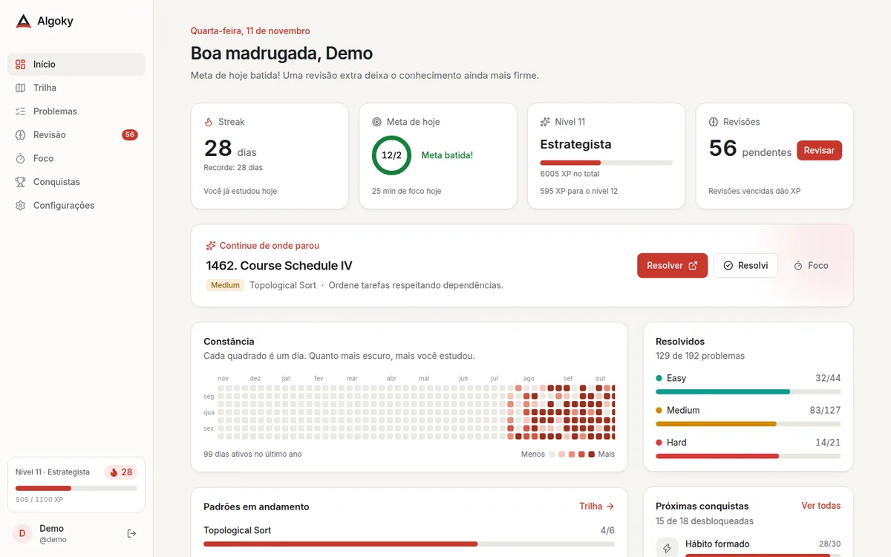
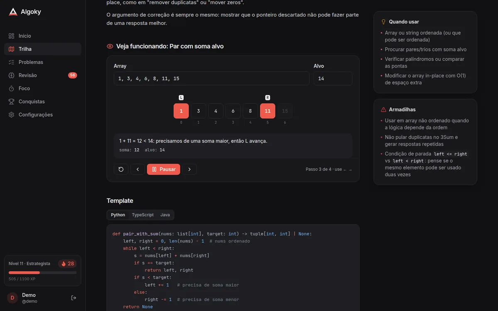
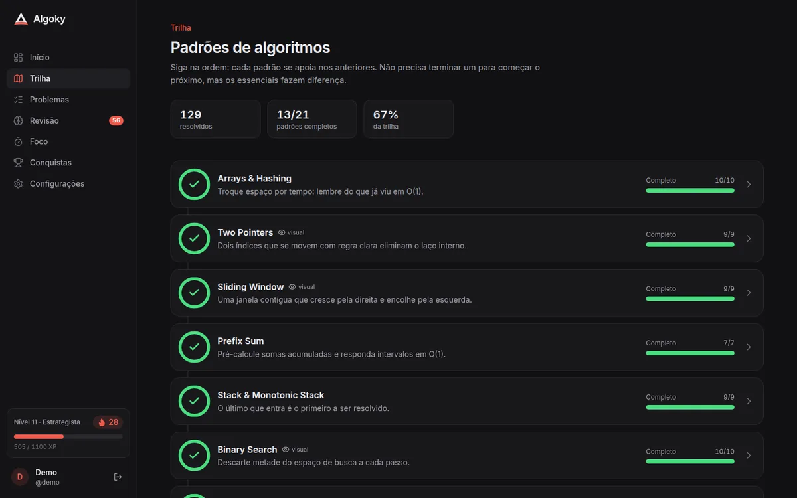
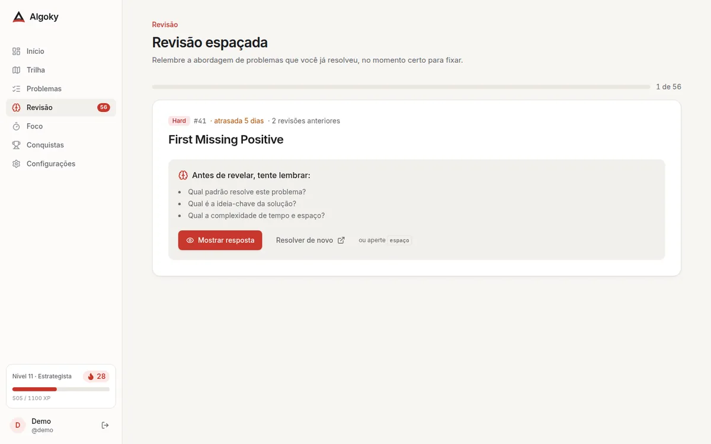
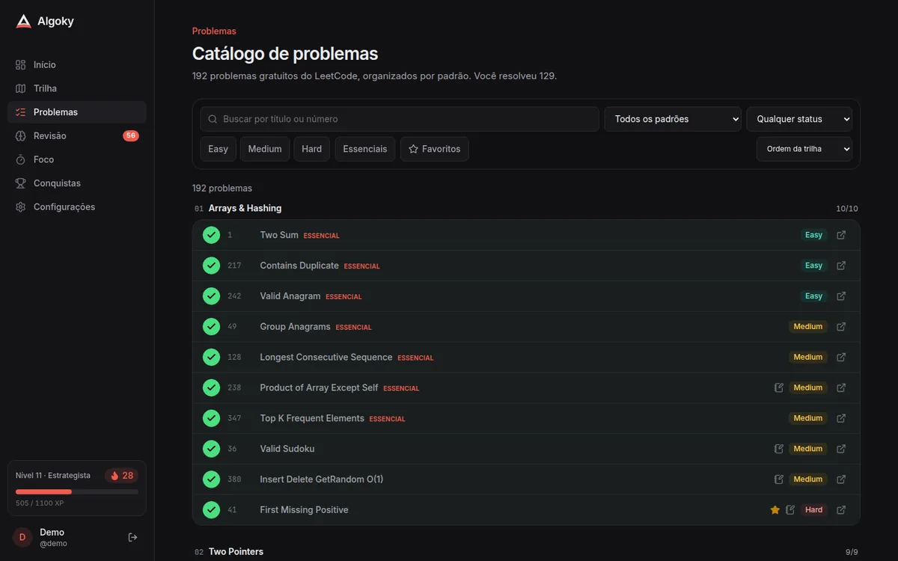

<div align="center">


# Algoky

**Transforme LeetCode em hábito.**

Plataforma de estudos de algoritmos e estruturas de dados: uma trilha com 21 padrões,
192 problemas curados do LeetCode, revisão espaçada, streak, XP e modo foco.

[](https://github.com/CaioRenatoDot/Algoky/actions/workflows/ci.yml)


</div>



## Por que existe

Estudar para entrevistas técnicas costuma falhar por dois motivos: **não saber o que estudar a seguir** e **não manter constância**. O Algoky resolve os dois:

- **O que estudar:** uma trilha em ordem pedagógica. Cada padrão tem explicação, sinais de quando usar, armadilhas, template em 3 linguagens e problemas essenciais. O painel sempre mostra o próximo problema.
- **Constância:** meta diária, streak, XP, níveis, conquistas e um heatmap do ano. A revisão espaçada traz de volta o que você já resolveu antes que você esqueça.

## Funcionalidades

|                              |                                                                                                  |
| ---------------------------- | ------------------------------------------------------------------------------------------------ |
| 🗺️ **Trilha de 21 padrões**  | De Arrays & Hashing até DP 2D, com pré-requisitos e o padrão recomendado agora                   |
| 📚 **192 problemas curados** | Só problemas gratuitos, conferidos contra o LeetCode, 94 marcados como essenciais                |
| 🧠 **Revisão espaçada**      | SM-2 simplificado: o intervalo cresce quando você lembra e volta para amanhã quando esquece      |
| 🔥 **Gamificação**           | XP, níveis com 8 títulos (de Iniciante a Lenda), streak com recorde, meta diária e 18 conquistas |
| 👀 **Visualizadores**        | Animações passo a passo de Two Pointers, Sliding Window e Binary Search, com entrada editável    |
| 🧩 **Templates**             | Python, TypeScript e Java com destaque de sintaxe e botão de copiar                              |
| ⏱️ **Modo foco**             | Timer persistente que sobrevive à navegação, com notificação e registro automático               |
| 📝 **Notas por problema**    | Salvamento automático; aparecem na hora da revisão                                               |
| 🌗 **Tema claro e escuro**   | Paletas próprias para cada tema, validadas para daltonismo                                       |
| 💾 **Seus dados**            | Exportação e importação em JSON e backup do SQLite com um comando                                |

<table>
  <tr>
    <td></td>
    <td></td>
  </tr>
  <tr>
    <td></td>
    <td></td>
  </tr>
</table>

## Começando

### Com Docker (recomendado)

```bash
git clone https://github.com/CaioRenatoDot/Algoky.git && cd Algoky
cp .env.example .env
docker compose up -d --build
```

Abra <http://localhost:3333> e crie sua conta. Se a instância for só sua, depois de criar a conta defina `ALLOW_REGISTRATION=false` no `.env` e rode `docker compose up -d` de novo.

Para colocar em produção com HTTPS, veja o [guia de deploy](docs/DEPLOY.md).

### Desenvolvimento local

Requer **Node.js 24** (ou 22.13+), por causa do `node:sqlite` nativo.

```bash
npm install
npm run seed -w @algoky/api   # opcional: conta demo / senha-demo-123 com 4 meses de histórico
npm run dev                   # API em :3333 e web em :5173 (com proxy para /api)
```

Abra <http://localhost:5173>.

## Scripts

| Comando                            | O que faz                                                                                               |
| ---------------------------------- | ------------------------------------------------------------------------------------------------------- |
| `npm run dev`                      | API (tsx watch) e web (Vite) juntos                                                                     |
| `npm run build`                    | Build de produção do web e bundle da API                                                                |
| `npm start`                        | Sobe a API do build a partir da raiz (use `WEB_DIST=apps/web/dist npm start` para servir o front junto) |
| `npm test`                         | Testes de todos os pacotes (Vitest)                                                                     |
| `npm run typecheck`                | TypeScript estrito em todos os pacotes                                                                  |
| `npm run lint` / `npm run format`  | ESLint / Prettier                                                                                       |
| `npm run seed -w @algoky/api`      | Cria a conta demo com histórico realista                                                                |
| `node apps/api/scripts/backup.mjs` | Backup consistente do banco (funciona com o servidor rodando)                                           |

## Configuração

Todas as opções são variáveis de ambiente. No Docker, use o `.env`.

| Variável             | Padrão                                       | Descrição                                                  |
| -------------------- | -------------------------------------------- | ---------------------------------------------------------- |
| `PORT`               | `3333`                                       | Porta HTTP                                                 |
| `HOST`               | `127.0.0.1` (dev) / `0.0.0.0` (prod)         | Interface de escuta                                        |
| `DATABASE_PATH`      | `data/algoky.db` (Docker: `/data/algoky.db`) | Arquivo SQLite                                             |
| `WEB_DIST`           | vazio (Docker: `/app/web`)                   | Pasta do build do frontend; se definida, a API serve o SPA |
| `ALLOW_REGISTRATION` | `true`                                       | `false` fecha novos cadastros                              |
| `COOKIE_SECURE`      | `false`                                      | `true` atrás de HTTPS (obrigatório em produção pública)    |
| `AUTH_RATE_LIMIT`    | `20`                                         | Tentativas de login/cadastro por IP por minuto             |
| `LOG_LEVEL`          | `info`                                       | Nível de log do pino                                       |

## Stack

| Camada        | Tecnologias                                                                                   |
| ------------- | --------------------------------------------------------------------------------------------- |
| Frontend      | React 19, Vite 8, Tailwind CSS v4, React Router, TanStack Query, Shiki, lucide                |
| Backend       | Fastify 5, zod, SQLite nativo do Node (`node:sqlite`), scrypt                                 |
| Compartilhado | `@algoky/shared`: domínio, regras de gamificação, revisão espaçada, conteúdo e contratos HTTP |
| Qualidade     | TypeScript estrito, Vitest, ESLint, Prettier, GitHub Actions                                  |
| Entrega       | Docker multi-stage (imagem única, usuário não root, healthcheck)                              |

```
apps/
  api/        Fastify + SQLite: autenticação, progresso, revisões, foco, dashboard
  web/        React SPA
packages/
  shared/     tipos, regras de domínio, conteúdo (padrões e problemas), contratos da API
docs/         arquitetura, API, deploy
```

## Documentação

- [Arquitetura](docs/ARCHITECTURE.md): visão geral, modelo de dados, regras de gamificação e de revisão, segurança e performance
- [API](docs/API.md): referência dos endpoints
- [Deploy](docs/DEPLOY.md): Docker, HTTPS com proxy reverso, backup, restauração e atualização
- [Contribuindo](CONTRIBUTING.md): fluxo de trabalho e como adicionar problemas ou padrões

## Licença

[MIT](LICENSE). LeetCode é marca de seus respectivos donos; o Algoky apenas aponta para os problemas públicos do site.
